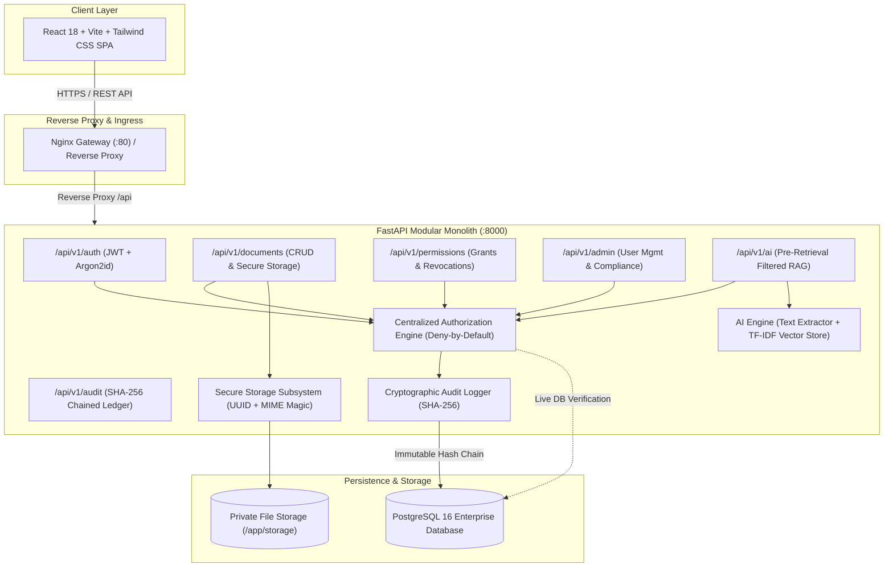

# TrustVault – Secure Enterprise Document Sharing & AI-Powered Document Intelligence Platform

[](https://www.python.org/)
[](https://fastapi.tiangolo.com/)
[](https://reactjs.org/)
[](https://www.typescriptlang.org/)
[](https://www.postgresql.org/)
[](https://www.docker.com/)
[](#core-security-invariants)

**TrustVault** is a production-grade enterprise document management and AI intelligence platform built from the ground up on a **"Security First. AI Second."** architecture. Designed to solve enterprise document sprawl, unauthorized lateral sharing, and untraceable access, TrustVault enforces strict deny-by-default role-based access control (RBAC), fine-grained per-document permissions, instant access revocation, cryptographically chained audit trails, and zero-leakage offline AI search and Q&A.

---

## Table of Contents
1. [Architectural Overview](#architectural-overview)
2. [Core Security Invariants](#core-security-invariants)
3. [Key Technical Decisions & Rationale](#key-technical-decisions--rationale)
4. [User Roles & Permissions](#user-roles--permissions)
5. [Getting Started & Local Development](#getting-started--local-development)
   - [Option A: Docker Compose (Recommended)](#option-a-docker-compose-production-ready)
   - [Option B: Local Development Setup](#option-b-local-development-setup)
   - [Database Seeding & Demo Accounts](#database-seeding--demo-accounts)
6. [API Route Reference](#api-route-reference)
7. [AI & Document Intelligence Subsystem](#ai--document-intelligence-subsystem)
8. [Testing & Quality Assurance](#testing--quality-assurance)
9. [Known Limitations & Future Roadmap](#known-limitations--future-roadmap)

---

## Architectural Overview

TrustVault follows a **modular monolith** architecture designed for enterprise reliability, high auditability, and zero cross-tenant metadata leakage:



---

## Core Security Invariants

TrustVault is engineered around non-negotiable security principles:

1. **Deny by Default**: No user—regardless of role—has access to any document or metadata without an explicit ownership record or an active grant.
2. **Administrator Isolation Boundary**: System administrators manage accounts, roles, and compliance reports. **Administrators have zero inherent access to confidential document contents or metadata** unless explicitly shared by the document owner.
3. **Immediate Revocation**: Document permissions are evaluated on **every single request** against the live transactional database. Permissions are never cached in JWT claims or distributed sessions. Revoking access blocks subsequent downloads, metadata queries, and AI embeddings immediately.
4. **Cryptographic Tamper-Evident Audit Logging**: Every system action, login attempt, access violation, and AI query produces a canonicalized SHA-256 hash-chained audit record ($H_n = \text{SHA-256}(H_{n-1} + \text{Payload})$). Tampering with any log record invalidates all subsequent verification hashes.
5. **Private Storage Isolation**: Uploaded documents are stored outside the web root with randomly generated UUIDv4 storage keys. Raw user filenames and client-supplied paths are never used on disk, preventing directory traversal and direct URL guessing.
6. **Pre-Retrieval AI Isolation**: Vector similarity searches and RAG question answering filter the retrieval corpus **before** vector distance calculations occur. Unauthorized documents never enter the candidate set or context windows.

---

## Key Technical Decisions & Rationale

| Decision | Alternative Considered | Rationale |
| :--- | :--- | :--- |
| **Argon2id Password Hashing** | Bcrypt, PBKDF2 | Argon2id is the winner of the Password Hashing Competition (PHC) and OWASP's top recommendation, offering superior resistance against GPU/ASIC brute-force attacks and side-channel timing attacks. |
| **Centralized Authorization Service** | Decentralized route-level checks | Centralizing authorization in `AuthzService` eliminates code duplication, prevents inconsistent permission logic, and guarantees uniform audit logging for both allowed and denied attempts across all API endpoints. |
| **Live Database Access Checks** | Permissions encoded in JWT | Storing document IDs or permission scopes inside JWT claims prevents immediate revocation until token expiration (e.g. 60 minutes). TrustVault queries PostgreSQL on every request to ensure sub-millisecond revocation enforcement. |
| **SHA-256 Hash Chaining** | Plain database logging | Hash chaining links each log entry to the cryptographic digest of the prior entry. If an attacker with database access alters or drops a record, the entire verification chain breaks, immediately alerting auditors. |
| **Offline Deterministic Vector Search (TF-IDF + Cosine)** | External LLM APIs (OpenAI/Cloud) | Enterprise confidential documents must not leave the customer perimeter. Our offline vector engine requires zero external network access, produces deterministic results, and eliminates data leakage risks. |
| **Pydantic v2 + SQLAlchemy 2.0** | Raw SQL queries / Django ORM | Strict compile-time typing, parameterized query generation against SQL injection, and high-performance serialization via Pydantic v2 core. |

---

## User Roles & Permissions

| Role | Responsibilities & Capabilities | Restrictions |
| :--- | :--- | :--- |
| **ADMIN** | User lifecycle management (activation/deactivation), role promotion, full audit activity review, cryptographic chain verification, security anomaly reporting. | **No automatic access to confidential documents.** Cannot view, download, or search documents unless granted permission by the owner. |
| **OWNER** | Upload documents, view/download own documents, update metadata, delete documents, grant permissions, revoke permissions, view per-document audit logs. | Cannot modify other users' documents or view unshared documents. Cannot modify platform-wide user accounts. |
| **VIEWER** | View metadata and download documents shared with `READ` grant. Edit document content only if explicitly granted `EDIT` permission. | Cannot upload documents. Cannot share or revoke permissions. Cannot view audit logs or user directories. |

### Document Permissions:
- **`READ`**: Authorizes viewing metadata, downloading original files, and including document content in authorized AI queries.
- **`EDIT`**: Authorizes updating document metadata, replacing content versions, and full read capabilities.

---

## Getting Started & Local Development

### Prerequisites
- Python 3.11+
- Node.js 18+ & npm
- Docker & Docker Compose (for containerized deployment)
- Git

---

### Option A: Docker Compose (Production Ready)

Launch the entire stack (PostgreSQL, Backend API, and Frontend SPA) with a single command:

```bash
# Clone the repository
git clone https://github.com/your-username/Trust_vault_AG.git
cd Trust_vault_AG

# Launch multi-container stack in detached mode
docker-compose up --build -d

# Verify all containers are healthy
docker-compose ps
```

The services will be available at:
- **Frontend Dashboard**: `http://localhost` (Port 80)
- **Backend API**: `http://localhost/api/v1` (Proxied) or `http://localhost:8000` (Direct)
- **Interactive Swagger Docs**: `http://localhost:8000/docs`

To seed the database with initial enterprise users and sample documents:
```bash
docker-compose exec backend python scripts/seed_db.py
```

---

### Option B: Local Development Setup

#### 1. Backend Setup
```bash
# Navigate to workspace root
cd Trust_vault_AG

# Create and activate Python virtual environment
python -m venv .venv
# On Windows:
.venv\Scripts\activate
# On Linux/macOS:
source .venv/bin/activate

# Install backend dependencies
pip install -r backend/requirements.txt

# Run database seeder (initializes database and demo accounts)
python scripts/seed_db.py

# Start FastAPI development server
uvicorn backend.app.main:app --reload --host 127.0.0.1 --port 8000
```

#### 2. Frontend Setup
```bash
# In a separate terminal, navigate to frontend directory
cd frontend

# Install node packages
npm install

# Start Vite development server
npm run dev
```

Frontend will be accessible at: `http://localhost:5173`

---

### Database Seeding & Demo Accounts

TrustVault includes a comprehensive seeder script (`scripts/seed_db.py`) creating test accounts for all roles and scenarios:

| Username | Password | Role | Description / Permissions |
| :--- | :--- | :--- | :--- |
| `admin` | `AdminPass123!` | **ADMIN** | Full administrative visibility, user management, audit inspection. Cannot access unshared docs. |
| `alice_owner` | `OwnerPass123!` | **OWNER** | Owns "Q3 Financial Audit" and "Executive Employment Agreement". |
| `bob_owner` | `OwnerPass123!` | **OWNER** | Owns "Mutual Non-Disclosure Agreement". |
| `carol_viewer` | `ViewerPass123!` | **VIEWER** | Granted `READ` access to Alice's "Executive Employment Agreement". |
| `dave_viewer` | `ViewerPass123!` | **VIEWER** | Granted `EDIT` access to Bob's "Mutual NDA". |

---

## API Route Reference

All routes are versioned under `/api/v1`. Protected endpoints require standard `Authorization: Bearer <JWT>` header.

### 1. Authentication (`/api/v1/auth`)
| Method | Endpoint | Description | Auth Required |
| :--- | :--- | :--- | :--- |
| `POST` | `/register` | Self-register new user account (defaults to `VIEWER` or `OWNER`). | No |
| `POST` | `/login` | Authenticate using username and password; returns JWT token. | No |
| `GET` | `/me` | Retrieve profile and assigned role of authenticated user. | Yes |

### 2. Document Management (`/api/v1/documents`)
| Method | Endpoint | Description | Auth Required |
| :--- | :--- | :--- | :--- |
| `POST` | `/upload` | Upload new document with magic-byte and MIME validation. | Yes (`OWNER`, `ADMIN`) |
| `GET` | `/` | List all documents the user is authorized to access (owned or shared). | Yes |
| `GET` | `/{doc_id}` | Retrieve document metadata (authorized users only). | Yes |
| `GET` | `/{doc_id}/download` | Stream document file content securely (validates `READ`). | Yes |
| `PUT` | `/{doc_id}` | Update document title, description, or category (validates `EDIT`). | Yes |
| `DELETE`| `/{doc_id}` | Soft/hard delete document and remove storage file (Owner only). | Yes |

### 3. Permissions & Sharing (`/api/v1/permissions`)
| Method | Endpoint | Description | Auth Required |
| :--- | :--- | :--- | :--- |
| `POST` | `/{doc_id}/grant` | Grant `READ` or `EDIT` permission to another registered user. | Yes (Owner only) |
| `DELETE`| `/{doc_id}/revoke/{user_id}` | Immediately revoke user's document permission. | Yes (Owner only) |
| `GET` | `/{doc_id}/grants` | List all active permission grants for a document. | Yes (Owner only) |

### 4. Audit & Compliance (`/api/v1/audit`)
| Method | Endpoint | Description | Auth Required |
| :--- | :--- | :--- | :--- |
| `GET` | `/` | Query audit log trail with pagination and action filtering. | Yes (`ADMIN`, `OWNER`) |
| `GET` | `/verify` | Recalculate cryptographic SHA-256 hash chain and report tamper status. | Yes (`ADMIN`) |

### 5. Administration (`/api/v1/admin`)
| Method | Endpoint | Description | Auth Required |
| :--- | :--- | :--- | :--- |
| `GET` | `/users` | List all platform users, roles, and active statuses. | Yes (`ADMIN`) |
| `POST` | `/users` | Administrator-provisioned user creation. | Yes (`ADMIN`) |
| `PUT` | `/users/{user_id}/status` | Activate or deactivate user accounts. | Yes (`ADMIN`) |
| `PUT` | `/users/{user_id}/role` | Promote or change user platform role. | Yes (`ADMIN`) |
| `GET` | `/reports/export` | Export compliance activity log as CSV. | Yes (`ADMIN`) |

### 6. AI & Document Intelligence (`/api/v1/ai`)
| Method | Endpoint | Description | Auth Required |
| :--- | :--- | :--- | :--- |
| `POST` | `/query` | Ask natural language question across authorized document corpus. | Yes |
| `POST` | `/classify` | Automatically predict document category via ML classifier. | Yes |
| `GET` | `/anomalies` | Review security audit anomaly detection scores. | Yes (`ADMIN`) |

---

## AI & Document Intelligence Subsystem

TrustVault includes an embedded, private ML/AI pipeline that strictly respects document confidentiality:

1. **Text Extraction Subsystem**: Native support for PDF (`pypdf`), text files (`.txt`, `.md`), and tabular data (`.csv`), extracting clean text chunks with positional chunk indexing.
2. **Pre-Retrieval Authorization Filter**: When a user submits an AI query, the database first compiles the exact list of `document_ids` the user has an active grant or ownership for. Chunks belonging to any other document are excluded before vector calculations.
3. **TF-IDF Vector Store & Cosine Similarity**: An offline, deterministic vector space engine builds term-frequency vectors and computes cosine distances with strict similarity thresholds (`min_similarity >= 0.20`) to eliminate ungrounded hallucinations.
4. **Offline ML Category Classifier**: Multinomial Naive Bayes classifier trained on enterprise corpora to automatically categorize incoming documents into *Legal, Financial, Technical, HR, Compliance, or General*.
5. **Statistical Anomaly Detector**: Scans audit logs for brute-force login attempts, lateral access probing, or off-hours bulk download spikes.

---

## Testing & Quality Assurance

TrustVault includes a comprehensive Pytest test suite covering 51 automated tests across 7 distinct test modules:

```bash
# Run the complete test suite
pytest -v

# Run with test coverage report
pytest --cov=backend/app --cov-report=term-missing
```

### Test Suites:
1. `tests/test_auth.py`: Argon2id password hashing, JWT creation/expiry, registration validations, role restrictions.
2. `tests/test_authz_engine.py`: Deny-by-default logic, owner permissions, viewer read/edit limits, admin confidentiality boundary.
3. `tests/test_documents.py`: Upload validation, magic bytes, path traversal sanitization, download authorization, metadata updates, deletion.
4. `tests/test_permissions.py`: Granting permissions, live DB immediate revocation, permission upgrades/downgrades.
5. `tests/test_admin_and_audit.py`: User activation/deactivation, CSV export, audit trail filtering, tamper detection.
6. `tests/test_ai_rag.py`: Pre-retrieval AI isolation, admin exclusion from unauthorized AI answers, immediate revocation impact on AI answers.
7. `tests/test_security_master.py`: End-to-end multi-tenant privilege escalation and cross-user data leakage tests.

---

## Known Limitations & Future Roadmap

1. **Remotely Recall Local Downloads**: Once an authorized user downloads a raw PDF to their physical machine, that file cannot be recalled if access is later revoked. *(Mitigation: Implement encrypted client-side PDF DRM watermarking in future releases).*
2. **Database Superuser Audit Tampering**: While SHA-256 hash chaining detects record modification, a database superuser who alters records could mathematically recompute the entire chain from the point of edit. *(Mitigation: Anchor weekly root hashes to external immutable ledgers or RFC 3161 timestamping authorities).*
3. **Large-Scale Multi-Node Clustered Storage**: Currently utilizes a centralized filesystem storage volume. Production deployments at scale can integrate S3-compatible private object stores (MinIO/Ceph) using signed temporary proxy streams.

---

## License
MIT License. Developed for technical hiring challenge evaluation.
